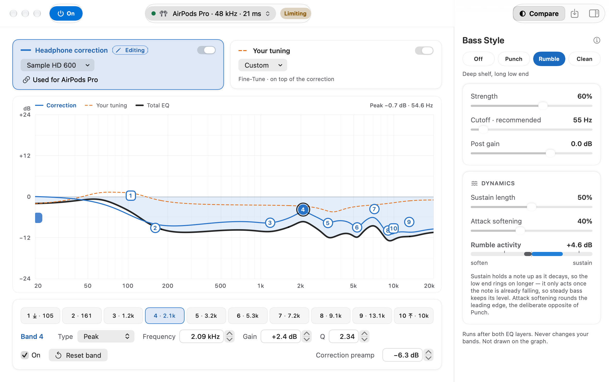
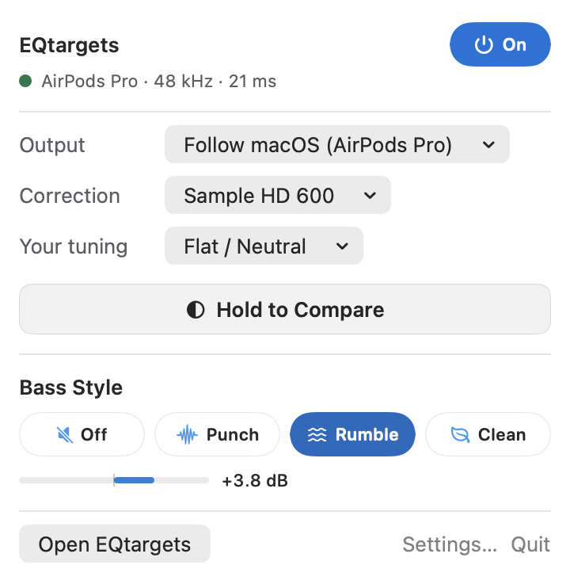

# EQtargets for Mac

A system-wide equalizer for macOS. It makes your headphones sound the way they were
measured to sound best, lets you add your own tuning on top, and gives the bass some
character. It works on every app (Music, Spotify, Safari, games, calls) and asks for
**no permissions**: no microphone access, no screen recording, no orange dot.

<picture>
  <source media="(prefers-color-scheme: dark)" srcset="docs/images/main-dark.png">
  
</picture>

## Download

**[Download the latest DMG](https://github.com/atrejokm301/EQtargetsMac/releases/latest)**,
then:

1. Open the DMG and drag **EQtargets** into **Applications**.
2. Open EQtargets. The app isn't signed with a paid Apple Developer ID, so the first
   time macOS says it can't check it for malware. Click **Done**, then go to
   **System Settings → Privacy & Security**, scroll down and click **Open Anyway**.
   You only do this once.

   *Prefer Terminal?* `xattr -dr com.apple.quarantine /Applications/EQtargets.app`
   does the same thing.
3. Click **Install Driver** and enter your Mac password. Sound pauses for a few seconds
   while macOS restarts its audio system.
4. Turn EQtargets **On**. That's it.

**Requires** macOS 15 Sequoia or later. The download is universal (Apple Silicon and
Intel), but it has only been tested on Apple Silicon.

## What it does

EQtargets stacks three independent layers. Each one can be switched off by itself,
and none of them overwrites another.

**1. Headphone correction.** Every headphone has its own frequency response: too much
bass here, a peak in the treble there. Projects like [AutoEQ](https://autoeq.app),
[squig.link](https://squig.link) and oratory1990 measure headphones and publish a
correction that brings them to a target sound. Import that file (`ParametricEQ.txt`,
or just paste the text) and EQtargets applies it as a 10-band parametric EQ. You can
link a correction to a device, so plugging in your AirPods applies the AirPods
correction automatically.

**2. Your tuning.** A second 10-band parametric EQ for your taste: type, frequency,
gain and Q for every band, plus a preamp. It sits on top of the correction, so you
can change your headphones without losing your tuning, and the reverse. Built-in
starting points: Flat, Bass Punch, Treble Smooth and Vocal Focus.

**3. Bass Style.** Four characters for the low end:

| Style | What you hear |
|---|---|
| **Off** | Exactly the two EQ layers, nothing more |
| **Punch** | Tighter kicks. Each bass note's attack is lifted and its tail trimmed |
| **Rumble** | Low notes ring longer. The sustain is lifted and the attack softened |
| **Clean** | A steady, gentle bass lift with no dynamic stage |

Punch and Rumble react to the music in real time, and a live meter shows how hard
they're working. Every style is **loudness-matched**, so switching styles compares the
character of the bass, not which one is louder.

**Also included:**
- **Compare.** Hold it to hear the music without EQ, then let go.
- **Output protection.** A lookahead limiter catches peaks at −1 dBFS, so boosting
  bands can't make the output clip or distort.
- **Click-free changes.** Dragging a band, switching a style or turning EQ off glides
  smoothly instead of popping.
- **A menu bar control** with power, output, correction, tuning and Bass Style.
- **Follows macOS.** Pick your AirPods or speakers in the Sound menu as usual, and
  EQtargets follows. Your volume keys keep working.

<p align="center">
  <picture>
    <source media="(prefers-color-scheme: dark)" srcset="docs/images/menu-dark.png">
    
  </picture>
</p>

## How it works

```
 every app
    │
    ▼
 "EQtargets Audio"   a virtual output device (Core Audio HAL plug-in, output-only)
    │   copies macOS's final mix, bit for bit, into shared memory
    ▼
 EQtargets.app
    │   drift-locked resampler            keeps two different clocks in sync
    │   → Headphone correction (10-band PEQ)
    │   → Your tuning (10-band PEQ)
    │   → Bass Style (shape + Punch/Rumble dynamics)
    │   → output protection (−1 dBFS lookahead limiter)
    ▼
 your real device    speakers, AirPods, headphones, DAC
```

**Getting the audio.** macOS doesn't let an app change other apps' sound, so EQtargets
installs a small audio driver, **EQtargets Audio**. While EQtargets is on, it becomes
macOS's output device. Every app plays into it, and macOS mixes everything as usual.

**Why it needs no permissions.** Most system-wide EQs capture audio through a
loopback *input* device, which needs microphone permission. Worse, an input device on
AirPods forces them into their low-quality headset mode. EQtargets Audio is
**output-only**: it has no input at all. Instead, the driver copies the mixed audio
into a block of shared memory, and the app reads it from there. That's why there's no
microphone prompt and no orange dot, and why AirPods stay in full-quality stereo.

**Keeping two clocks in sync.** The virtual device and your headphones each run on
their own clock, and no two clocks agree exactly. Left alone, the difference turns into
a click or a dropout every few minutes. EQtargets measures how full its buffer is and
continuously resamples by tiny amounts to match the real device. It uses a high-quality
windowed-sinc resampler, so you can't hear it (distortion below −110 dB).

**The EQ.** Both layers are standard parametric biquad filters (peak, low shelf and
high shelf), and the graph is drawn from the same math the audio uses. Every parameter
change glides to its new value over 20 ms, which is what keeps edits click-free.

**Bass Style.** A Linkwitz-Riley crossover splits off the low end. Two envelope
followers, one fast and one slow, tell the attack of a bass note from its sustain. Punch lifts the attack
and trims the tail, and Rumble does the opposite. Loudness matching uses K-weighting
(the ITU-R BS.1770 loudness curve) rather than peak level, because matching peaks makes
a heavier bass style sound *quieter*.

**Safety.** When you turn EQtargets off or quit, it hands the output back to your real
device. If the app ever crashes, the driver notices nobody is reading its audio, hides
itself, and macOS falls back to your speakers or headphones. Your Mac never stays
silent.

**Cost.** The whole chain uses about **0.4 % of one CPU core** (measured on Apple
Silicon), and it stops completely when no audio is playing.

## Privacy

EQtargets has no network code, no accounts and no analytics. The only link in the app
opens autoeq.app in your browser. Settings stay on your Mac.

## Uninstall

In EQtargets: **Settings → Driver → Uninstall Driver…** (it hands the output back
first), then drag the app to the Trash. To also erase the settings:
`defaults delete com.eqtargets.app`.

## Known limitations

- Not notarized by Apple, hence the one-time **Open Anyway** step.
- Audio interfaces with more than two outputs always play on channels 1–2.
- Tested on Apple Silicon only. The Intel build is included but has never been run.

## Building from source

You need Xcode and [XcodeGen](https://github.com/yonaskolb/XcodeGen) (`brew install xcodegen`).

```bash
xcodegen generate
xcodebuild -project EQtargets.xcodeproj -scheme EQtargets -configuration Release -derivedDataPath build/release build
# → build/release/Build/Products/Release/EQtargets.app (the driver is embedded inside)

scripts/make-dmg.sh      # the same build, packaged as build/dist/EQtargets_<version>_universal.dmg
```

Use the **Release** configuration for listening and performance work: the Debug DSP is
about 30× slower. Everything is ad-hoc signed, so no Apple account is needed.

The driver can also be installed without the app: `scripts/install-driver.sh` (and
`scripts/uninstall-driver.sh`). See [`Driver/README.md`](Driver/README.md).

### Tests

None of these need an admin password, and none change your audio output.

```bash
P=build/release/Build/Products/Release
xcodebuild -project EQtargets.xcodeproj -scheme EQTCoreTests -configuration Release -derivedDataPath build/release test   # DSP + models
xcodebuild -project EQtargets.xcodeproj -scheme eqt-driver-harness -configuration Release -derivedDataPath build/release build
xcodebuild -project EQtargets.xcodeproj -scheme eqt-engine -configuration Release -derivedDataPath build/release build
$P/eqt-driver-harness $P/EQtargetsAudio.driver    # loads the driver in-process with a fake host
$P/eqt-engine --offline-selftest                  # engine, routing logic and installer, on simulated time
```

### Layout

| Path | What |
|---|---|
| `Driver/` | The EQtargets Audio HAL plug-in (C) |
| `Shared/EQTRingProtocol.h` | The shared-memory contract between the driver and the app |
| `Sources/EQTCore/` | DSP and models: PEQ, Bass Style, limiter, resampler, ring reader |
| `Sources/EQTAudio/` | Core Audio glue: engine, device routing, output, driver installer |
| `Sources/App/` | The SwiftUI app and menu bar extra |
| `Tools/` | `eqt-probe` (diagnostics), `eqt-driver-harness`, `eqt-engine` (headless engine + self-tests) |
| `Tests/` | XCTest suite for the DSP |
| `docs/` | [Architecture](docs/ARCHITECTURE.md) and [design](docs/DESIGN.md) specs |

## Also from EQtargets

**[EQtargets Music](https://github.com/atrejokm301/EQtargetsMusic)** is the iPhone
version: a music player with the same correction, tuning and Bass Style layers. This
Mac app uses the same DSP.

## License

All rights reserved. The source is public so you can see how it works. Please ask
before redistributing it or publishing it under another name.
